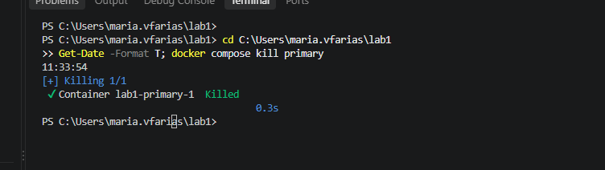
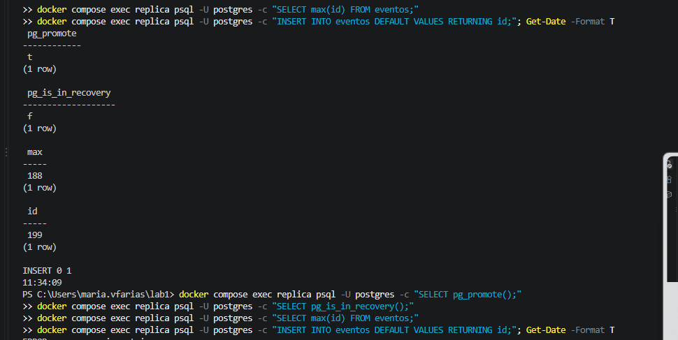

# 🛡️ Incidente B: servidor principal fora do ar (ransomware)

> **Resumo:** o primário foi derrubado em pleno horário de pico, a réplica foi promovida e o serviço voltou a aceitar escrita em **15 segundos**, sem perda de dados (**RPO = 0**).

---

## 📋 Contexto

Um ransomware criptografa o disco do banco principal em pleno horário de pico. Existe uma réplica PostgreSQL (replicação assíncrona).

**Roteiro executado:**

1. No `psql` do primário, simular pedidos chegando:
   ```sql
   INSERT INTO eventos DEFAULT VALUES RETURNING id;
   \watch 0.1
   ```
2. Em outro terminal, anotar **T0** e derrubar o primário, registrando o último id impresso antes do erro.
3. Promover a réplica e confirmar `pg_is_in_recovery() = false`.
4. Gravar uma linha no novo primário e anotar **T1**.

---

## 📊 Medições

| Medida | Valor |
|---|---|
| ⏱️ T0 (queda do primário) | 11:33:54 |
| ⏱️ T1 (primeira escrita no novo primário) | 11:34:09 |
| ⏳ **RTO** (T1 − T0) | **15 s** |
| 🔢 Último id confirmado | 188 |
| 🔢 `max(id)` no novo primário | 188 |
| 📉 **RPO** | **0 linhas** |

---

## 🔄 Failover

| Item | Detalhe |
|---|---|
| **Promovido** | Réplica `lab1-replica-1` (porta 5443) |
| **Comando** | `SELECT pg_promote();`, que retornou `t` |
| **Confirmação** | `SELECT pg_is_in_recovery();` retornou `f` (aceita escrita) |
| **Integridade** | `SELECT max(id) FROM eventos;` retornou 188, igual ao último id confirmado |

> 💡 **Observação sobre os ids:** o primeiro INSERT no novo primário recebeu o id 199, e não 189. A sequência `bigserial` reserva ids em blocos, então o salto na numeração não indica perda de linhas.

---

## 🛠️ Correção

**Ajuste na aplicação**
- Apontar a conexão para a porta **5443** (réplica promovida), em vez da 5442.
- Em produção, isso seria feito por DNS, IP virtual ou proxy, sem depender de alterar a aplicação.

**Por que o servidor antigo não pode voltar como primário sem ser reconstruído**
- 🔀 A promoção abriu uma nova *timeline*, e o antigo ficou na anterior: os históricos divergiram.
- ⚠️ Ele pode ter confirmado linhas que a réplica nunca recebeu. Se voltasse como primário, haveria dois primários aceitando escrita (*split-brain*).
- 🔒 O disco foi criptografado pelo ransomware e não é confiável.
- ✅ Só volta como **réplica do novo primário**, refeito com `pg_basebackup` (ou `pg_rewind`, se o disco estivesse íntegro).

---

## ❓ Respostas

### O que o RTO medido incluiu e deixou de fora?

O RTO cobriu apenas o intervalo entre a queda e a primeira escrita aceita no novo primário, feito manualmente (promoção e INSERT).

Ficaram de fora:
- 🔍 **Detecção** da falha (aqui a queda foi provocada);
- 🧑‍💻 **Decisão** de promover a réplica;
- 🌐 **DNS/endereço** de conexão;
- 🔌 **Reconexão da aplicação**.

Em um incidente real, o RTO seria maior que 15 s.

### Por que o RPO deu 0 e quando seria maior?

Na replicação assíncrona, o primário confirma o commit sem esperar a réplica. O RPO foi 0 porque a carga era baixa (cerca de 10 inserts por segundo) e a rede é local, então a réplica recebeu o WAL em milissegundos. Isso **não é garantia**.

O RPO seria maior com:
- 🐢 atraso de replicação (rede lenta ou réplica sobrecarregada);
- 📈 carga de escrita alta ou cargas em lote;
- 🔌 réplica desconectada antes da queda.

---

## 🖼️ Evidências

**T0: queda do primário (11:33:54)**



**Promoção da réplica e T1 (11:34:09)**

